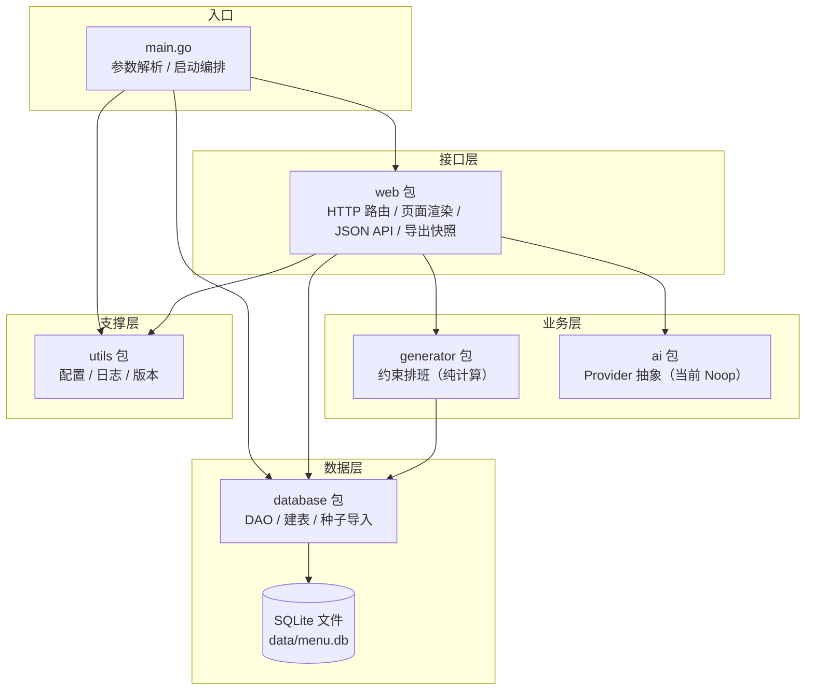
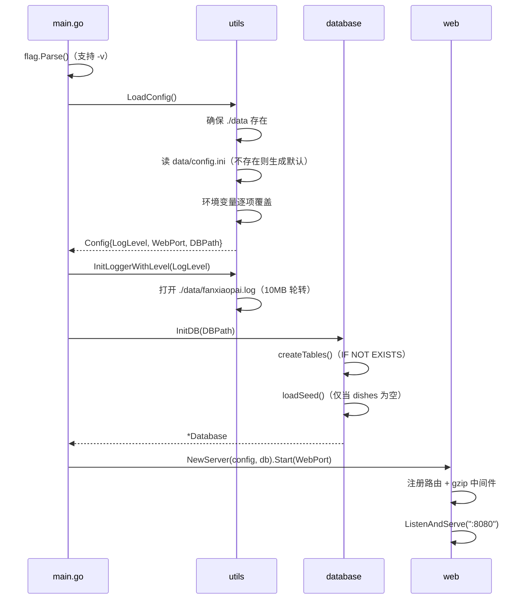
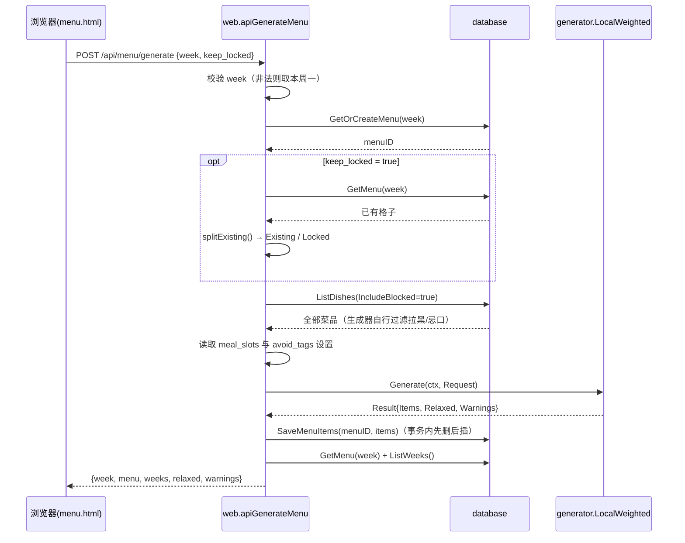
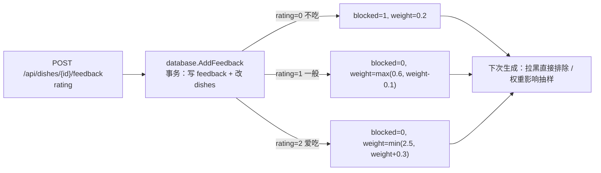
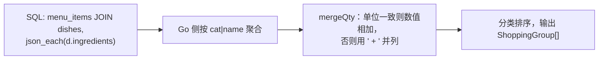

# 02 整体架构

## 1. 分层视图



要点：

- `web` 是唯一同时依赖 `database`、`generator`、`ai`、`utils` 的包，负责把 HTTP 请求翻译成领域操作。
- `generator` 只依赖 `database` 的**类型与常量**（`Dish`、`Cell` 用到的槽位/类型枚举），不执行任何 SQL。
- `database` 不反向依赖 `generator` / `web`，依赖方向单一。
- `ai` 不依赖任何内部包，便于替换实现。

## 2. 包依赖矩阵

| 包 | 依赖 | 被谁依赖 |
|---|---|---|
| `main` | `database`、`utils`、`web` | — |
| `utils` | 标准库 | `main`、`web` |
| `database` | `modernc.org/sqlite`、`embed`、标准库 | `main`、`web`、`generator` |
| `generator` | `database`、标准库 | `web` |
| `ai` | 标准库 | `web` |
| `web` | `database`、`generator`、`ai`、`utils` | `main` |

不存在循环依赖。新增功能时建议保持：**算法不碰 SQL，HTTP 层不直接拼 SQL**。

## 3. 启动时序



启动阶段能容忍的失败：

- 默认配置文件写不出来只记警告，继续以默认值运行（`utils/config.go`）。
- 数据库初始化失败会打印错误并退出。
- 监听失败会恢复控制台日志后记录错误。

## 4. 核心数据流

### 4.1 生成整周菜单



关键点：

- **黑名单与忌口不在这里过滤**，而是全部交给生成器，保证「过滤规则」只有一处。
- 保存采用「整周覆盖」：`DELETE FROM menu_items WHERE menu_id = ?` 后逐条插入，单事务。
- 生成结果附带 `relaxed`（放宽级别）与 `warnings`（中文提示），直接展示给用户。

### 4.2 单格换菜

1. 读取当前周菜单，拆成 `Existing`。
2. 构造 `Target = {day_index, slot, seq}`。
3. 生成器只排目标格；其他已有格子计入状态但不再重排。
4. 只把目标格的新菜写回（`SetMenuItem`，UPSERT）。
5. 返回最新整周菜单。

### 4.3 打分与权重联动



### 4.4 采购清单



### 4.5 离线快照

`GET /export?week=...`：读取菜单、采购清单、勾选状态，把预编译的 `app.css` **内联**进模板，渲染出一个没有任何外部引用、没有 JS 的独立 HTML。`?download=1` 时附加 `Content-Disposition` 作为附件下载。

## 5. 运行时状态与并发

| 项 | 事实 |
|---|---|
| 进程模型 | 单进程，`http.ListenAndServe` 一个监听器 |
| 数据库连接 | `sql.Open("sqlite", path)` + `SetMaxOpenConns(1)` |
| 写并发 | 依赖单个数据库连接串行化；菜品/菜单写入均在事务中完成 |
| 生成器随机源 | `*rand.Rand`，构造时注入；生产使用时间种子，测试固定种子 |
| 生成耗时保护 | 每级放宽最多尝试 6 次，并带 200ms 软截止时间 |
| 日志并发 | `Logger` 用互斥锁保护文件写入与轮转 |

> 注意：`database.InitDB` 的注释提到 WAL，但代码中没有执行 `PRAGMA journal_mode=WAL`，实际使用的是驱动默认日志模式。若未来强调读写并发，可显式设置 PRAGMA。

## 6. 配置、数据与代码的关系

```text
环境变量 (LOG_LEVEL / WEB_PORT / DB_PATH)
        │ 最高优先级
        ▼
data/config.ini  [server] log_level / web_port / db_path
        │ 次优先级
        ▼
内置默认值 warn / 8080 / ./data/menu.db
        │
        ▼
utils.Config → main.go → database.InitDB / web.Start
```

`web.Server` 结构体持有 `config` 字段，但当前代码没有读取它；端口由 `main` 直接传给 `Start`。排餐、忌口等业务配置来自数据库 `settings` 表，而不是 ini 文件。
