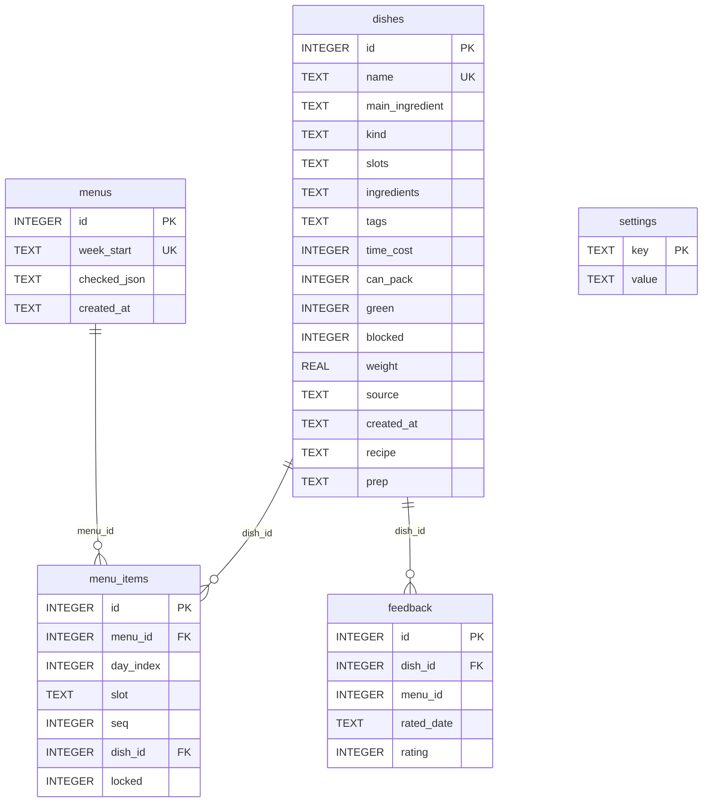

# 03 数据模型

## 1. 实体关系



建表语句集中在 `database.createTables()`（[database.go](../database/database.go)），全部使用 `IF NOT EXISTS`，重复启动安全。没有外键约束，删除菜品由应用层事务级联清理。

## 2. 表结构明细

### 2.1 `dishes`（菜品库）

| 列 | 类型 | 默认 | 说明 |
|---|---|---|---|
| `id` | INTEGER PK AUTOINCREMENT | — | 主键 |
| `name` | TEXT NOT NULL UNIQUE | — | 菜名，唯一；重名插入会报 UNIQUE 错误，API 转成「已经有同名的一道菜了」 |
| `main_ingredient` | TEXT | `'素'` | 主料枚举：鸡/猪/牛/鱼/虾/蛋/豆腐/素 |
| `kind` | TEXT NOT NULL | — | 类型枚举：荤菜/素菜/汤/主食/快手 |
| `slots` | TEXT JSON | `'[]'` | 可出现的餐次：breakfast/lunch/dinner |
| `ingredients` | TEXT JSON | `'[]'` | `[{name, cat, qty}]` |
| `tags` | TEXT JSON | `'[]'` | 忌口标签，如 `辛辣`、`花生`、`海鲜` |
| `time_cost` | INTEGER | `20` | 预计耗时（分钟） |
| `can_pack` | INTEGER 0/1 | `0` | 是否适合带饭 |
| `green` | INTEGER 0/1 | `0` | 是否绿叶菜 |
| `blocked` | INTEGER 0/1 | `0` | 是否拉黑；生成时直接排除 |
| `weight` | REAL | `1.0` | 基础抽样权重，由反馈维护 |
| `source` | TEXT | `'seed'` | `seed`（内置）/ `user`（用户新增） |
| `created_at` | TEXT | `''` | `YYYY-MM-DD HH:MM:SS` |
| `recipe` | TEXT | `''` | 做法，多行文本，菜单页点菜名时展示 |
| `prep` | TEXT | `''` | 备料，多行文本 |

`last_made` **不是表字段**，而是查询时通过子查询动态计算：

```sql
(SELECT MAX(date(m.week_start, '+' || mi.day_index || ' days'))
   FROM menu_items mi JOIN menus m ON m.id = mi.menu_id
  WHERE mi.dish_id = d.id) AS last_made
```

即：菜的 `last_made` = 它最近一次被排进菜单的**实际日期**（周一日期 + 天序号）。

### 2.2 `menus`（周菜单）

| 列 | 类型 | 说明 |
|---|---|---|
| `id` | INTEGER PK | 主键 |
| `week_start` | TEXT UNIQUE | 该周周一日期 `YYYY-MM-DD`，唯一 |
| `checked_json` | TEXT JSON | 采购勾选状态，键为 `"分类|食材名"`，值为 `true` |
| `created_at` | TEXT | 创建时间 |

### 2.3 `menu_items`（菜单格子）

| 列 | 类型 | 说明 |
|---|---|---|
| `id` | INTEGER PK | 主键 |
| `menu_id` | INTEGER | 所属菜单 |
| `day_index` | INTEGER | 0=周一 … 6=周日 |
| `slot` | TEXT | breakfast/lunch/dinner |
| `seq` | INTEGER | 该餐次内第几道菜（0 起） |
| `dish_id` | INTEGER | 菜品 ID |
| `locked` | INTEGER 0/1 | 锁定后重排不会动这一格 |

唯一约束：`UNIQUE(menu_id, day_index, slot, seq)`。索引：`idx_menu_items_menu(menu_id)`。

### 2.4 `feedback`（反馈）

| 列 | 类型 | 说明 |
|---|---|---|
| `id` | INTEGER PK | 主键 |
| `dish_id` | INTEGER | 菜品 ID |
| `menu_id` | INTEGER | 来源菜单（可为 0） |
| `rated_date` | TEXT | 评分日期 `YYYY-MM-DD`，缺省取当天 |
| `rating` | INTEGER | 0 不吃 / 1 一般 / 2 爱吃 |

唯一约束：`UNIQUE(dish_id, rated_date)`。同一天对同一道菜重复评分会**覆盖**而不是新增。索引：`idx_feedback_dish(dish_id)`。

### 2.5 `settings`（键值设置）

| 列 | 类型 | 说明 |
|---|---|---|
| `key` | TEXT PK | 设置键 |
| `value` | TEXT | 值（多为 JSON 文本） |

当前使用的键：

| key | value 格式 | 默认值 |
|---|---|---|
| `meal_slots` | `{"0":["breakfast","dinner"],...,"6":["breakfast","lunch","dinner"]}` | 工作日早晚、周末三餐 |
| `avoid_tags` | `["花生","海鲜"]` | `[]` |

默认值常量位于 [web/web.go](../web/web.go)（`defaultMealSlots`）与 `web/api_menu.go`（`avoidTags` 的 `"[]"` 回退）。

## 3. 枚举常量

定义于 [database/model.go](../database/model.go)：

| 分类 | 常量 | 值 |
|---|---|---|
| 餐次 | `SlotBreakfast` / `SlotLunch` / `SlotDinner` | `breakfast` / `lunch` / `dinner` |
| 菜品类型 | `KindMeat` | `荤菜` |
| | `KindVeg` | `素菜` |
| | `KindSoup` | `汤` |
| | `KindStap` | `主食` |
| | `KindQuick` | `快手` |
| 评分 | `RatingDislike` / `RatingNormal` / `RatingLike` | `0` / `1` / `2` |

主料枚举（分散在 `database/seed.go` 与 `web/api_dishes.go` 的 `validMainIngredients`）：

```text
鸡、猪、牛、鱼、虾、蛋、豆腐、素
```

食材分类（影响采购清单分组与 emoji）：

```text
肉蛋、水产、蔬菜、豆制品、米面、调料、其他
```

## 4. JSON 列约定

`Slots` / `Tags` 是字符串数组；`Ingredients` 是对象数组：

```json
{
  "name": "鸡胸肉",
  "cat": "肉蛋",
  "qty": "300g"
}
```

读写转换封装在 `database/database.go`：

| 函数 | 作用 |
|---|---|
| `marshalList` / `unmarshalList` | `[]string` ↔ JSON 文本，nil 归一为 `[]` |
| `marshalIngredients` / `unmarshalIngredients` | `[]Ingredient` ↔ JSON 文本 |

解析失败时返回空切片而不是报错，保证坏数据不会让整库不可读（但种子文件在导入前有严格校验）。

## 5. 种子数据

- 文件：[database/seed/dishes.json](../database/seed/dishes.json)，通过 `//go:embed seed/dishes.json` 打包。
- 结构：`{"dishes": [ {name, main_ingredient, kind, slots, ingredients, tags, time_cost, can_pack, green, recipe, prep}, ... ]}`。
- 数量：122 道（按 README 描述），覆盖早餐主食/快手、荤菜、素菜、汤等。
- 导入策略：
  - `loadSeed()`：仅当 `SELECT COUNT(*) FROM dishes` 为 0 时全量导入，之后一条都不写。
  - `RestoreSeedDishes()`：按菜名比对，只插入库中不存在的，已有记录字段一律不动。
- 导入前校验（`parseSeed()`）：
  1. 菜名非空且不重复；
  2. `main_ingredient` 在允许集合内；
  3. `kind` 在允许集合内；
  4. `slots` 至少一个且每个合法；
  5. `ingredients` 至少一个（否则采购清单会漏）；
  6. `time_cost > 0`；
  7. 类型为「素菜」且 `green=true` 时，主料必须是「素」。

任何一条不合法都会**直接报错退出**，避免带着脏菜库运行。

## 6. 数据一致性约定

| 场景 | 行为 |
|---|---|
| 删除菜品 | 事务内先删 `menu_items`、再删 `feedback`、最后删 `dishes`（应用层级联） |
| 整周保存菜单 | 事务内先删该菜单全部 `menu_items`，再逐条插入 |
| 单格更新 | `INSERT ... ON CONFLICT(menu_id, day_index, slot, seq) DO UPDATE SET dish_id=...`（不改变 locked） |
| 锁定切换 | 直接 `UPDATE menu_items SET locked=?`，要求该格已存在 |
| 反馈写入 | 事务内 UPSERT feedback + 更新 dishes 的 `blocked`/`weight` |
| 勾选状态 | 整份 JSON 覆盖写 `menus.checked_json` |

## 7. 数据备份

所有状态都在 `data/`：

- `menu.db`（+ 可能的 `-wal` / `-shm`）
- `config.ini`（可选，默认值可重建）
- `fanxiaopai.log`（无业务价值）

备份只需拷贝 `data/` 目录；Docker 部署对应宿主机挂载的 `./data`。
