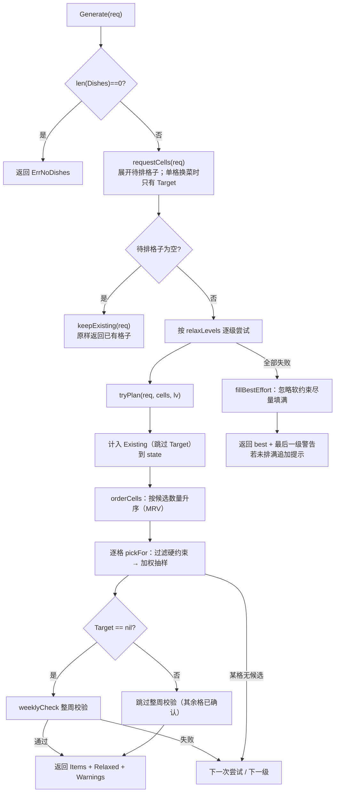

# 05 排班算法

实现文件：[generator/generator.go](../generator/generator.go)；测试：[generator/generator_test.go](../generator/generator_test.go)。

生成器是一个**纯计算组件**：输入完整菜库与约束，输出「哪些格子放哪道菜」。它不访问数据库，不感知 HTTP。

---

## 1. 输入与输出

```go
type Cell struct {
    DayIndex int    // 0=周一 … 6=周日
    Slot     string // breakfast / lunch / dinner
    Seq      int    // 该餐次内第几道菜，从 0 开始
}

type Request struct {
    WeekStart string           // 周一日期（当前算法未使用，见 §8）
    MealSlots map[int][]string // 每天排哪些餐
    Dishes    []database.Dish  // 候选菜（生成器自行过滤拉黑与忌口）
    AvoidTags []string         // 忌口标签
    Existing  map[Cell]int64   // 已排好的格子
    Locked    map[Cell]bool    // 锁定格，不参与重排
    Target    *Cell            // 非空时只重排这一格
    Now       time.Time        // "久未做"计算的基准时间，测试可固定
}

type Item struct {
    Cell
    DishID int64
}

type Result struct {
    Items    []Item   // 排好的全部格子
    Relaxed  int      // 放宽到第几级，0 表示完全满足
    Warnings []string // 放宽了什么，直接展示给用户
}
```

错误约定：

- 菜库为空（`len(req.Dishes)==0`）返回 `ErrNoDishes`。
- 其他情况算法保证返回结果（可能不满格，并通过 `Warnings` 明确说明）。

---

## 2. 角色模型：每个格子从哪个池子选菜

`slotRoles` 定义了「格内角色 → 接受的菜品类型」：

| 餐次 | seq | 角色 | 接受的 `kind` |
|---|---|---|---|
| breakfast | 0 | carb（碳水） | 主食 |
| breakfast | 1 | protein（蛋白） | 快手 |
| lunch | 0 | meat | 荤菜 |
| lunch | 1 | veg | 素菜 |
| lunch | 2 | side | 汤 或 主食 |
| dinner | 0 | meat | 荤菜 |
| dinner | 1 | veg | 素菜 |
| dinner | 2 | side | 汤 或 主食 |

因此：早餐固定 2 格，有午餐/晚餐的日子每餐 3 格。

### 2.1 主池选空时的借用顺序

`fallbackKinds` 只在该格的**主池完全为空**时启用，属于兜底而非常规路径：

| 角色 | 借用顺序 |
|---|---|
| carb | 快手 → 素菜 |
| protein | 素菜 → 汤 |
| meat | 素菜 → 快手 |
| veg | 快手 → 汤 |
| side | 快手 → 素菜 |

---

## 3. 约束清单

### 3.1 硬约束（始终生效）

| 约束 | 实现位置 | 说明 |
|---|---|---|
| 拉黑排除 | `filterPool` | `d.Blocked` 直接跳过 |
| 餐次匹配 | `filterPool` + `hasSlot` | 菜必须声明可在该餐次出现 |
| 类型匹配 | `filterPool` + `hasKind` | 按角色要求的 `kind` 过滤 |
| 忌口排除 | `filterPool` + `hasAnyTag` | 菜标签命中任一忌口即排除 |
| 耗时上限 | `filterPool` + `timeLimit` | 早餐 ≤20 分钟；工作日非早餐 ≤35；周末 ≤90。降级到第 4 级时忽略 |
| 同菜不重复 | `filterPool` | 第 0–2 级整周一道菜只出现一次；第 3–4 级放宽为间隔 ≥2 天 |
| 荤菜主料间隔 | `filterPool` | 第 0–3 级：同主料荤菜 48 小时内（天序号差 <2）不重复；第 4 级取消 |
| 每天有绿叶菜 | `filterPool` + `state.hasGreenAvailable` | 第 0 级生效；仅当该格还有绿叶菜可选时才强制 |
| 鱼虾每周至少 2 次 | `weeklyCheck` + `seafoodAvailable` | 仅第 0–1 级做整周校验；可用鱼虾不足 2 道时不强制 |
| 锁定格不动 | `requestCells` | 锁定格不进入待排列表，但计入已用状态 |

### 3.2 软约束（影响权重，不排除候选）

| 因素 | 权重变化 | 说明 |
|---|---|---|
| 菜品基础权重 | `d.Weight`（≤0 时按 1.0） | 由反馈维护 |
| 从未做过 | ×1.2 | `LastMade == ""` |
| 最近 7 天内做过 | ×0.7 | 让菜单换得开 |
| 8–14 天前做过 | ×1.0 | 中性 |
| 超过 14 天没做 | ×1.3 | 提权 |
| 鱼虾且周中后仍缺次数 | ×1.8 | 当 `2 - seafood > 0` 且 `day >= 7 - needed` |
| 当天还没有绿叶菜且该菜是绿叶菜 | ×1.5 | 放宽后仍鼓励绿叶菜 |

多因素相乘，最终按权重做一次累加抽样（`pickFor`）；总权重 ≤0 时退化为等概率随机。

---

## 4. 降级阶梯

`relaxLevels` 从严格到宽松共 5 级：

| 级别 | 每天绿叶菜 | 整周不重复 | 荤菜主料 48h 间隔 | 耗时上限倍数 |
|---|---|---|---|---|
| 0 | 是 | 是 | 是 | 1.0 |
| 1 | 否 | 是 | 是 | 1.0 |
| 2 | 否 | 否（改为间隔 ≥2 天） | 是 | 1.0 |
| 3 | 否 | 否 | 否 | 1.5 |
| 4 | 否 | 否 | 否 | 0（忽略耗时） |

对每一级最多尝试 **6 次**；同时有一个 **200ms 软截止时间**（`req.Now + 200ms`），超时后不再尝试更深级别。成功即返回该级结果与对应警告；所有级别都失败时进入尽力而为兜底（`fillBestEffort`），能填几格填几格。

> 软截止时间只在「尝试失败」的间隙检查，单次尝试本身没有超时控制。

---

## 5. 算法流程



### 5.1 `requestCells`

- 若 `req.Target != nil`，只返回目标格。
- 否则遍历 7 天 × 当天配置的餐次 × 该餐次角色数，跳过 `req.Locked` 中的格子。
- 餐次按「早餐 → 午餐 → 晚餐」排序。

### 5.2 `tryPlan`

1. `state` 记录已用菜、上次出现天、荤菜主料上次出现天、每天是否已有绿叶菜、鱼虾数量。
2. 先把 `Existing` 中除 `Target` 外的格子计入 `items` 和 `state`（锁定格与其他已确认格不重排，但占位）。
3. `orderCells` 用 MRV（Minimum Remaining Values）策略：先填候选最少的格子，降低「排到最后无菜可选」的概率。**注意候选数是在计入全部已有格之后一次性计算的，不会随填充过程动态更新。**
4. 逐格 `pickFor`，任一格无候选则本次尝试失败。
5. 非单格换菜时执行 `weeklyCheck`。

### 5.3 `weeklyCheck`

- 只在 `lv.level <= 1` 时真正检查（更高放宽级别直接通过）。
- 鱼虾数量 `< 2` 且库中可用鱼虾 `>= 2` 时失败。
- 第 0 级还要求每个有正餐的日子至少有一道 `green=true` 的菜。

### 5.4 `fillBestEffort`

使用 `relax{level: 9, timeMul: 0}`（即不限制耗时），不执行整周校验，按顺序能给每格选菜就选，选不到就留空。返回结果会带：
- 最后一级的放宽警告；
- 若有空格，追加「有格子没排上菜，菜库里符合条件的菜不够，去菜库加几道吧」。

---

## 6. 单格换菜与锁定

| 场景 | 行为 |
|---|---|
| `Target != nil` | 只排目标格；`Existing` 中目标格以外的菜全部计入状态，保证不会换成整周已用过的菜；跳过整周校验（避免推翻用户已确认的其他格） |
| 锁定格 | `requestCells` 跳过，不重新选菜；但仍计入 `state.used`，避免其他格重复选它 |
| 整周全锁定 | 待排格子为空，`keepExisting` 原样返回 |

---

## 7. 测试覆盖

`generator_test.go` 使用固定随机种子 `42` 与一个接近真实比例的合成菜库（`bigLibrary()`），覆盖：

| 测试 | 验证点 |
|---|---|
| `TestGenerateFillsEveryCell` | 默认排餐下格子数为 `7*2 + 9*3 = 41`，菜库充足时 `Relaxed == 0` |
| `TestBreakfastOnlyFromQuickAndStaple` | 早餐只出现主食/快手 |
| `TestMeatMainIngredientNotRepeatedWithin48Hours` | 同主料荤菜相邻天不重复 |
| `TestBlockedAndAvoidedDishesNeverAppear` | 拉黑与忌口菜不出现 |
| `TestEveryMainMealDayHasGreenVegetable` | 每天都有绿叶菜（第 0 级） |
| `TestTinyLibraryStillProducesResult` | 极小菜库也能出结果，3 秒内完成，且 `Relaxed > 0` |
| `TestLockedCellsAreKept` | 锁定格保持原菜 |
| `TestKeepLockedRerollHasNoDuplicateCells` | 「保留锁定重排」真实入参（`Existing` 含整周、`Locked` 只标几格）下无重复格、锁定格不被换（v0.3.2 回归） |
| `TestRerollSingleCellOnlyChangesThatCell` | 单格换菜只改目标格 |
| `TestEmptyLibraryReturnsError` | 空菜库返回 `ErrNoDishes` |

运行：

```bash
go test ./...
go test ./generator -v
```

---

## 8. 实现细节与已知限制

以下是阅读代码时值得注意的点，修改相关逻辑前应确认：

1. **`Request.WeekStart` 未被算法使用**
   注释写着「仅用于计算最近做过」，但实际「最近做过」由 `database` 查询的 `Dish.LastMade` 提供，`Generate` 中没有任何地方读取 `WeekStart`。保留字段主要是接口语义完整性。

2. **`ctx` 未被使用**
   `Generate(ctx, req)` 的 `context` 参数没有参与取消检查，长耗时场景无法通过 ctx 中断（目前只有 200ms 软截止时间兜底）。

3. **`keep_locked=true` 的重复格子问题已修复（v0.3.2）**
   曾经的风险：`web.splitExisting` 把**所有**已有格子放进 `Existing`，而 `requestCells` 只跳过锁定格，导致未锁定格既被 `tryPlan` 原样计入、又被生成循环重新选菜，`SaveMenuItems` 撞 `UNIQUE(menu_id, day_index, slot, seq)` 返回「保存菜单失败」。现在 `Generate` 拿到待排 `cells` 后，先把 `req.Existing` 收敛为「只保留不在 `cells` 中的格子」（`inCells` / `kept`）：要重排的格子统一交给生成循环产出，不再重复计入。回归测试 `TestKeepLockedRerollHasNoDuplicateCells` 覆盖真实入参（`Existing` 含整周、`Locked` 只标几格），断言无重复格且锁定格保持原菜。

4. **`orderCells` 的候选数是静态快照**
   计算后填充过程中 `state.used` 会变化，MRV 排序不会动态调整。对小规模菜库影响可接受。

5. **绿叶菜规则的兜底**
   `state.hasGreenAvailable` 会检查当天是否还有可用绿叶菜；如果没有，就不再强制绿叶菜，避免把格子逼空。因此第 0 级也可能出现「当天没有绿叶菜但通过校验」的情况（`weeklyCheck` 会再检查一次，但只针对有正餐的日子）。

6. **`fallbackKinds` 只在主池为空时触发**
   例如荤菜池为空时会借素菜/快手，这可能让「荤菜格」出现非荤菜。这是有意为之的兜底，降级警告文案不会单独提示「用了替代类型」。

7. **结果排序**
   `sortItems` 依次按 `DayIndex`、餐次顺序、`Seq` 排序，保证输出稳定。
